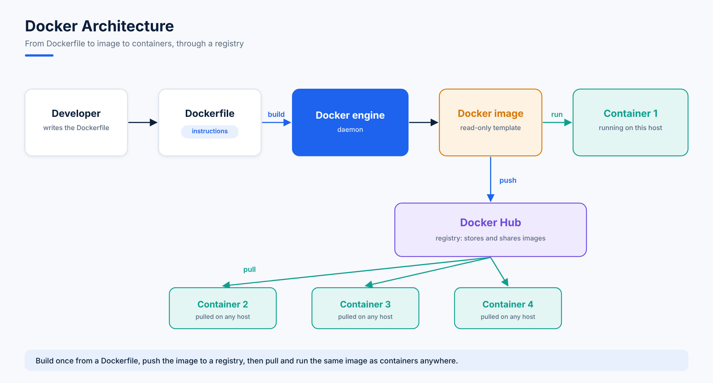

# 01. Docker and Containers

## What Is Docker?

Docker is an open-source, centralized platform for **creating, deploying and running applications** inside containers.

| Feature | What it means |
|---|---|
| **Container-based** | Applications run in containers on top of the host operating system. |
| **Kernel sharing** | Containers share the host's Linux kernel, which keeps them lightweight and fast. |
| **Cross-platform** | Docker can be installed on any OS, but the Docker Engine runs natively on Linux. |
| **Language** | Docker is written in Go. |
| **Virtualization type** | OS-level virtualization, better known as **containerization**. |

**History:** first released in March 2013, created by Solomon Hykes and Sebastien Pahl.

**Docker vs VMware:** Docker is a Platform as a Service (PaaS) that uses **OS-level** virtualization, while VMware uses **hardware-level** virtualization.

## Advantages of Docker

- **No pre-allocated RAM:** containers use memory dynamically, only as needed.
- **CI friendly:** build an image once and reuse it across the whole deployment pipeline.
- **Cost-effective:** lightweight containers reduce infrastructure costs.
- **Lightweight:** containers are smaller and start faster than virtual machines.
- **Flexible deployment:** runs on physical hardware or in the cloud.
- **Reusable images:** the same image works across multiple environments.
- **Fast deployment:** container-based apps deploy quickly with minimal overhead.

## Disadvantages of Docker

- **Limited GUI support:** not a good fit for apps that need a rich graphical interface.
- **Scaling complexity:** managing many containers is hard without an orchestrator (this is where Kubernetes comes in).
- **Not truly cross-platform:** a container built for one OS family may not behave the same on another (for example Ubuntu vs CentOS).

## Docker Building Blocks

1. **Docker Engine:** the core software that runs containers. It builds, runs and manages containers, using Linux kernel features such as **cgroups** and **namespaces** for isolation.
2. **Docker Client:** the `docker` command you type in the terminal. It sends your commands to the Docker daemon (`dockerd`), acting as the bridge between you and the engine.
3. **Docker Host:** the physical or virtual machine where Docker Engine is installed. It holds the OS, the engine, and all the images and containers.

## Docker Architecture

1. A developer writes a **Dockerfile** listing the required software and dependencies.
2. The **Docker Engine** executes the Dockerfile and creates a **Docker image**.
3. A **container** is created from the image. A container is a **layered file system**.
4. The image can be pushed to **Docker Hub** (a registry) so it is publicly available.
5. Anyone can then pull the image from Docker Hub and create more containers from it.
