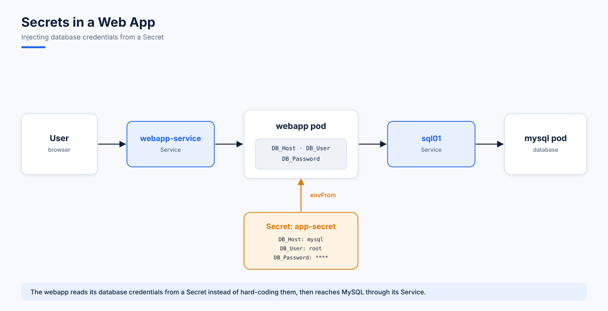

# 14. Secrets

**Secrets** store sensitive data such as passwords, OAuth tokens and SSH keys. Unlike ConfigMaps, their values are **base64-encoded** and their visibility can be limited to authorized pods and users. Pods consume them as environment variables, as mounted volumes, or through the Kubernetes API. Keeping secret data out of application code improves security and makes it easier to manage.

## Important Notes on Secrets

1. Secrets are **base64-encoded, not encrypted**, so they are not secure by default.
2. **Never commit Secret objects** to source control alongside application code.
3. By default, Secrets are stored **unencrypted in etcd**. Enable **encryption at rest** to protect them.
4. Anyone who can create pods or deployments in a namespace can potentially read its Secrets. Limit this with **least-privilege RBAC**.
5. For stronger security, consider external secret managers: **AWS Secrets Manager, Azure Key Vault, GCP Secret Manager or HashiCorp Vault**.

## The Lab: A Web App Connecting to MySQL



The web app reads its database connection details (`DB_Host`, `DB_User`, `DB_Password`) from a Secret and connects to MySQL through the `sql01` Service.

```console
[root@client1 ahmad]# kubectl get secrets
No resources found in default namespace.
```

### Step 1: The web app pod and its NodePort Service

The first version had no database settings:

```yaml
# web-pod.yaml (first version)
apiVersion: v1
kind: Pod
metadata:
  name: webapp-pod
  namespace: default
  labels:
    name: webapp-pod
spec:
  containers:
    - name: webapp
      image: kodekloud/simple-webapp-mysql
```

The final version loads every key of the `db-secret` Secret as environment variables:

```yaml
# web-pod.yaml (final version)
apiVersion: v1
kind: Pod
metadata:
  name: webapp-pod
  namespace: default
  labels:
    name: webapp-pod
spec:
  containers:
    - name: webapp
      image: kodekloud/simple-webapp-mysql
      envFrom:
        - secretRef:
            name: db-secret
```

```yaml
# web-app-svc.yaml
apiVersion: v1
kind: Service
metadata:
  name: webapp-service
  namespace: default
spec:
  type: NodePort
  selector:
    name: webapp-pod
  ports:
    - port: 8080
      targetPort: 8080
      nodePort: 30080
      protocol: TCP
```

```console
[root@client1 ahmad]# kubectl apply -f web-pod.yaml
pod/webapp-pod created
[root@client1 ahmad]# kubectl apply -f web-app-svc.yaml
service/webapp-service created
[root@client1 ahmad]# kubectl get svc -o wide
NAME             TYPE        CLUSTER-IP      EXTERNAL-IP   PORT(S)          AGE     SELECTOR
kubernetes       ClusterIP   10.96.0.1       <none>        443/TCP          4d22h   <none>
webapp-service   NodePort    10.96.151.164   <none>        8080:30080/TCP   4m13s   name=webapp-pod

[root@client1 ahmad]# kubectl get nodes -o wide
NAME                       STATUS   ROLES           AGE   VERSION   INTERNAL-IP   EXTERNAL-IP   OS-IMAGE                         KERNEL-VERSION          CONTAINER-RUNTIME
my-cluster-control-plane   Ready    control-plane   6d    v1.32.2   172.25.0.2    <none>        Debian GNU/Linux 12 (bookworm)   5.14.0-542.el9.x86_64   containerd://2.0.2
my-cluster-worker          Ready    <none>          6d    v1.32.2   172.25.0.3    <none>        Debian GNU/Linux 12 (bookworm)   5.14.0-542.el9.x86_64   containerd://2.0.2
```

At this point `172.25.0.3:30080` **fails**: there is no database yet.

### Step 2: The MySQL pod and its Service

An init script, loaded through a ConfigMap, lets the web app log in with the native password plugin:

```sql
-- mysql-init.sql
ALTER USER 'root'@'%' IDENTIFIED WITH mysql_native_password BY 'password123';
FLUSH PRIVILEGES;
```

```console
[root@client1 ahmad]# kubectl create configmap mysql-init --from-file=mysql-init.sql
configmap/mysql-init created
```

```yaml
# mysql-pod.yaml
apiVersion: v1
kind: Pod
metadata:
  name: mysql
  labels:
    name: mysql
spec:
  containers:
    - name: mysql
      image: mysql:8.0
      ports:
        - containerPort: 3306
      env:
        - name: MYSQL_ROOT_PASSWORD
          value: "password123"
      args: ["--default-authentication-plugin=mysql_native_password", "--ssl=0"]
      volumeMounts:
        - name: init-script
          mountPath: /docker-entrypoint-initdb.d
  volumes:
    - name: init-script
      configMap:
        name: mysql-init
```

```yaml
# mysql-pod-svc.yaml
apiVersion: v1
kind: Service
metadata:
  name: sql01
  namespace: default
spec:
  selector:
    name: mysql
  ports:
    - port: 3306
      targetPort: 3306
      protocol: TCP
  type: ClusterIP
```

```console
[root@client1 ahmad]# kubectl apply -f mysql-pod.yaml
pod/mysql created
[root@client1 ahmad]# kubectl apply -f mysql-pod-svc.yaml
service/sql01 created
[root@client1 ahmad]# kubectl get po,svc
NAME             READY   STATUS              RESTARTS        AGE
pod/mysql        0/1     ContainerCreating   0               20s
pod/webapp-pod   1/1     Running             2 (6m47s ago)   14m

NAME                     TYPE        CLUSTER-IP      EXTERNAL-IP   PORT(S)          AGE
service/kubernetes       ClusterIP   10.96.0.1       <none>        443/TCP          4d23h
service/sql01            ClusterIP   10.96.75.119    <none>        3306/TCP         11s
service/webapp-service   NodePort    10.96.151.164   <none>        8080:30080/TCP   14m
```

### Step 3: Create the Secret

```console
[root@client1 ahmad]# kubectl create secret generic db-secret --from-literal=DB_Host=sql01 --from-literal=DB_User=root --from-literal=DB_Password=password123
secret/db-secret created
[root@client1 ahmad]# kubectl get secrets
NAME        TYPE     DATA   AGE
db-secret   Opaque   3      8s
```

`describe` shows only the **size** of each value, never the value itself:

```console
[root@client1 ahmad]# kubectl describe secret db-secret
Name:         db-secret
Namespace:    default
Type:  Opaque

Data
====
DB_Host:      5 bytes
DB_Password:  11 bytes
DB_User:      4 bytes
```

Recreate `webapp-pod` with the `envFrom: secretRef` version; `kubectl describe po webapp-pod` then lists `db-secret` under *Environment Variables from*.

```console
[root@client1 ahmad]# kubectl describe svc webapp-service
Selector:                 name=webapp-pod
Type:                     NodePort
IP:                       10.96.151.164
Port:                     <unset>  8080/TCP
TargetPort:               8080/TCP
NodePort:                 <unset>  30080/TCP
Endpoints:                10.244.1.4:8080
```

### Step 4: Success

```console
[root@client1 ahmad]# curl http://172.25.0.3:30080
<!doctype html>
<title>Hello from Flask</title>
<body style="background: #39b54b;"></body>
...
    <h3> Successfully connected to the MySQL database.</h3>

    <h2> Environment Variables: DB_Host=sql01; DB_Database=Not Set; DB_User=root; DB_Password=password123;  </h2>

    <p> From webapp-pod!</p>
```

The page also shows why Secrets need care: any app that receives them can print them.

## Useful Secret Commands

```bash
# create from literals or from a file
kubectl create secret generic app-secret --from-literal=DB_HOST=mysql
kubectl create secret generic app-secret --from-file=app_secret.properties

# encode and decode values by hand (for Secret YAML files)
echo -n 'mysql' | base64
echo -n 'bXlzcWw=' | base64 --decode
```

| Use a Secret as | YAML |
|---|---|
| All keys as env vars | `envFrom: - secretRef: name: <secret>` |
| One key as an env var | `env: - name: DB_Password valueFrom: secretKeyRef: name: <secret> key: DB_Password` |
| Files in a volume | `volumes: - name: s secret: secretName: <secret>` plus a `volumeMount` |
