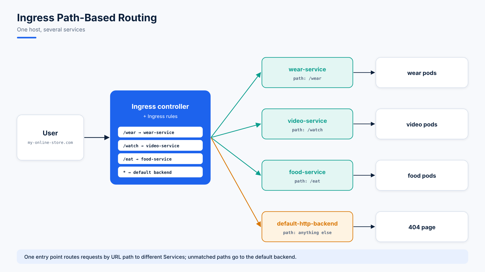

# 26. Ingress Networking

## What Is Ingress?

**Ingress** is a traffic manager for requests coming **from outside** the cluster. Instead of exposing every app with its own NodePort or LoadBalancer, Ingress exposes **many apps behind one IP or domain**, routing by **URL path** or **hostname**:

```
yourdomain.com/app1  →  App1
yourdomain.com/app2  →  App2
```

**Problems it solves:**

- **Cost:** one load balancer instead of many.
- **Clean URLs:** all apps organized under one domain.
- **Central control:** one place to manage external access.
- **Security:** HTTPS/TLS support.

## How It Works: You Need Both Parts

| Part | What it is |
|---|---|
| **Ingress Controller** | A program running in the cluster that reads the rules and does the routing (NGINX, Traefik, HAProxy) |
| **Ingress Resource** | Your YAML routing rules ("send `/blog` to the blog service") |

Steps: deploy a controller, create the Ingress resource, and optionally point your domain's DNS at the controller's public IP.

```yaml
apiVersion: networking.k8s.io/v1
kind: Ingress
metadata:
  name: my-ingress
spec:
  rules:
  - host: mysite.com
    http:
      paths:
      - path: /app1
        pathType: Prefix
        backend:
          service:
            name: app1-service
            port:
              number: 80
```

**HTTPS:** add a `tls` section to the Ingress and use **cert-manager** to issue free certificates from Let's Encrypt automatically.

| Feature | With Ingress |
|---|---|
| Load balancers | One for many apps |
| Access by | URL path or hostname |
| Cost | Lower |
| Security | HTTPS (TLS) |
| Management | Central and flexible |

## The Lab: An E-Commerce Site with Three Apps



| Path | Service | App |
|---|---|---|
| `/wear` | `wear-service:8080` | Apparel shop |
| `/watch` | `video-service:8080` | Video streaming |
| `/eat` | `food-service:8080` | Food delivery |
| anything else | `default-backend-service:80` | 404 page |

# Part 1: Ingress on Minikube

### Enable the NGINX ingress add-on

```bash
minikube start
minikube addons enable ingress
```

(It's best to delete the kind cluster first.) Check which context is active:

```console
[ahmad@client1 ~]$ kubectl config get-contexts
CURRENT   NAME                    CLUSTER                 AUTHINFO                NAMESPACE
          kind-cloudops-cluster   kind-cloudops-cluster   kind-cloudops-cluster
*         minikube                minikube                minikube                default
```

To go back to kind later: `kubectl config use-context kind-kind`.

```console
[ahmad@client1 ~]$ kubectl create ns app-space
namespace/app-space created
[ahmad@client1 ~]$ kubectl get po -n ingress-nginx
NAME                                        READY   STATUS      RESTARTS   AGE
ingress-nginx-admission-create-96hrl        0/1     Completed   0          6m49s
ingress-nginx-admission-patch-8dg58         0/1     Completed   2          6m49s
ingress-nginx-controller-56d7c84fd4-2rxwx   1/1     Running     0          8m50s
```

```console
[ahmad@client1 ~]$ kubectl get svc -n ingress-nginx
NAME                                 TYPE        CLUSTER-IP       EXTERNAL-IP   PORT(S)                      AGE
ingress-nginx-controller             NodePort    10.106.85.85     <none>        80:30885/TCP,443:30095/TCP   8m50s
ingress-nginx-controller-admission   ClusterIP   10.104.165.122   <none>        443/TCP                      8m50s
```

### Deploy the three apps (all in `app-space`)

```yaml
# wear-deploy.yaml
apiVersion: apps/v1
kind: Deployment
metadata:
  name: webapp-wear
  namespace: app-space
spec:
  replicas: 1
  selector:
    matchLabels:
      app: webapp-wear
  template:
    metadata:
      labels:
        app: webapp-wear
    spec:
      containers:
      - image: kodekloud/ecommerce:apparels
        name: wear-webapp
        ports:
        - containerPort: 8080
          protocol: TCP
```

```yaml
# wear-clusterip.yaml
apiVersion: v1
kind: Service
metadata:
  name: wear-service
  namespace: app-space
spec:
  ports:
  - port: 8080
    protocol: TCP
    targetPort: 8080
  selector:
    app: webapp-wear
  type: ClusterIP
```

`video-deploy.yaml` / `video-clusterip.yaml` (image `kodekloud/ecommerce:video`, Service `video-service`) and `food-deploy.yaml` / `food-clusterip.yaml` (image `kodekloud/ecommerce:food`, Service `food-service`) follow exactly the same pattern.

```console
[ahmad@client1 ~]$ kubectl get deploy
No resources found in default namespace.
[ahmad@client1 ~]$ kubectl get deploy -n app-space
NAME           READY   UP-TO-DATE   AVAILABLE   AGE
webapp-food    1/1     1            1           14s
webapp-video   1/1     1            1           7m46s
webapp-wear    1/1     1            1           16m

[ahmad@client1 ~]$ kubectl get svc -n app-space
NAME            TYPE        CLUSTER-IP      EXTERNAL-IP   PORT(S)    AGE
food-service    ClusterIP   10.110.132.74   <none>        8080/TCP   10s
video-service   ClusterIP   10.97.146.213   <none>        8080/TCP   5m33s
wear-service    ClusterIP   10.99.196.198   <none>        8080/TCP   13m
```

Each Service works from inside the Minikube node:

```console
[ahmad@client1 ~]$ minikube ssh
docker@minikube:~$ curl 10.99.196.198:8080
<!doctype html>
<title>Hello from Flask</title>
<body style="background: #2980b9;">
    

docker@minikube:~$ curl 10.97.146.213:8080
<body style="background: #30336b;">
    

docker@minikube:~$ curl 10.110.132.74:8080
<body style="background: #30336b;">
    
```

### The default backend (for unknown paths)

```yaml
# default-deploy.yaml
apiVersion: apps/v1
kind: Deployment
metadata:
  name: default-backend
  namespace: app-space
spec:
  replicas: 1
  selector:
    matchLabels:
      app: default-backend
  template:
    metadata:
      labels:
        app: default-backend
    spec:
      containers:
      - image: kodekloud/ecommerce:404
        name: default-webapp
        ports:
        - containerPort: 8080
          protocol: TCP
```

```yaml
# default-clusterip.yaml
apiVersion: v1
kind: Service
metadata:
  name: default-backend-service
  namespace: app-space
spec:
  ports:
  - port: 80
    protocol: TCP
    targetPort: 8080
  selector:
    app: default-backend
  type: ClusterIP
```

```console
[ahmad@client1 ~]$ kubectl get svc -n app-space
NAME                      TYPE        CLUSTER-IP      EXTERNAL-IP   PORT(S)    AGE
default-backend-service   ClusterIP   10.104.71.137   <none>        80/TCP     8s
food-service              ClusterIP   10.110.132.74   <none>        8080/TCP   8m47s
video-service             ClusterIP   10.97.146.213   <none>        8080/TCP   14m
wear-service              ClusterIP   10.99.196.198   <none>        8080/TCP   22m
```

### The Ingress resource

```yaml
# ingress-resource.yaml
apiVersion: networking.k8s.io/v1
kind: Ingress
metadata:
  annotations:
    nginx.ingress.kubernetes.io/rewrite-target: /
    nginx.ingress.kubernetes.io/ssl-redirect: "false"
  name: ingress-wear-watch
  namespace: app-space
spec:
  rules:
  - http:
      paths:
      - backend:
          service:
            name: wear-service
            port:
              number: 8080
        path: /wear
        pathType: Prefix
      - backend:
          service:
            name: video-service
            port:
              number: 8080
        path: /watch
        pathType: Prefix
      - backend:
          service:
            name: food-service
            port:
              number: 8080
        path: /eat
        pathType: Prefix
  defaultBackend:
    service:
      name: default-backend-service
      port:
        number: 80
```

`rewrite-target: /` strips the path prefix, so the apps receive `/` instead of `/wear`.

```console
[ahmad@client1 ~]$ kubectl apply -f ingress-resource.yaml
ingress.networking.k8s.io/ingress-wear-watch created
[ahmad@client1 ~]$ kubectl get ingress
No resources found in default namespace.
[ahmad@client1 ~]$ kubectl get ingress -n app-space
NAME                 CLASS   HOSTS   ADDRESS        PORTS   AGE
ingress-wear-watch   nginx   *       192.168.49.2   80      59s

[ahmad@client1 ~]$ kubectl describe ingress -n app-space
Name:             ingress-wear-watch
Namespace:        app-space
Address:          192.168.49.2
Ingress Class:    nginx
Default backend:  default-backend-service:80 (10.244.0.9:8080)
Rules:
  Host        Path  Backends
  ----        ----  --------
  *
              /wear    wear-service:8080 (10.244.0.6:8080)
              /watch   video-service:8080 (10.244.0.7:8080)
              /eat     food-service:8080 (10.244.0.8:8080)
Annotations:  nginx.ingress.kubernetes.io/rewrite-target: /
              nginx.ingress.kubernetes.io/ssl-redirect: false
Events:
  Normal  Sync    55s (x2 over 102s)  nginx-ingress-controller  Scheduled for sync
```

### Testing the routes

One IP, three apps:

```console
docker@minikube:~$ curl 192.168.49.2/wear
<body style="background: #2980b9;">
    

docker@minikube:~$ curl 192.168.49.2/watch
<body style="background: #30336b;">
    

docker@minikube:~$ curl 192.168.49.2/eat
<body style="background: #30336b;">
    

docker@minikube:~$ curl 192.168.49.2/anythingelse
<html>
<head><title>404 Not Found</title></head>
<body>
<center><h1>404 Not Found</h1></center>
<hr><center>nginx</center>
</body>
</html>
```

# Part 2: Ingress on kind with MetalLB

kind has no cloud load balancer, so **MetalLB** provides `LoadBalancer` IPs from the node network.

### Cluster and apps

```yaml
# kind-config.yaml
kind: Cluster
apiVersion: kind.x-k8s.io/v1alpha4
nodes:
  - role: control-plane
  - role: worker
  - role: worker
```

Recreate `app-space` and apply the same deployments and Services:

```console
[root@client1 ahmad]# kubectl create ns app-space
namespace/app-space created
[root@client1 ahmad]# kubectl get po -n app-space
NAME                               READY   STATUS    RESTARTS   AGE
default-backend-77748d7d54-q66xz   1/1     Running   0          103s
webapp-food-6c4fb545cc-6nm5t       1/1     Running   0          103s
webapp-video-67f9967c79-gcf99      1/1     Running   0          103s
webapp-wear-5bf97f7947-4k64l       1/1     Running   0          2m50s
[root@client1 ahmad]# kubectl get svc -n app-space
NAME                      TYPE        CLUSTER-IP      EXTERNAL-IP   PORT(S)    AGE
default-backend-service   ClusterIP   10.96.156.142   <none>        80/TCP     108s
food-service              ClusterIP   10.96.5.195     <none>        8080/TCP   108s
video-service             ClusterIP   10.96.191.94    <none>        8080/TCP   108s
wear-service              ClusterIP   10.96.4.32      <none>        8080/TCP   2m55s
```

### Install MetalLB

```console
[root@client1 ahmad]# kubectl apply -f https://raw.githubusercontent.com/metallb/metallb/v0.14.9/config/manifests/metallb-native.yaml
namespace/metallb-system created
customresourcedefinition.apiextensions.k8s.io/ipaddresspools.metallb.io created
customresourcedefinition.apiextensions.k8s.io/l2advertisements.metallb.io created
...
deployment.apps/controller created
daemonset.apps/speaker created

[root@client1 ahmad]# kubectl get po -n metallb-system
NAME                         READY   STATUS    RESTARTS   AGE
controller-bb5f47665-76t2r   1/1     Running   0          8m51s
speaker-76qsq                1/1     Running   0          8m51s
speaker-8987f                1/1     Running   0          8m51s
speaker-st7vt                1/1     Running   0          8m51s
```

Give MetalLB an address pool in the **same range as the node IPs** (`172.25.0.x`):

```yaml
# metal-lb.yaml
apiVersion: metallb.io/v1beta1
kind: IPAddressPool
metadata:
  name: first-pool
  namespace: metallb-system
spec:
  addresses:
  - 172.25.0.1-172.25.0.10
  - fc00:f853:0ccd:e799::/124
```

### Install the NGINX ingress controller (bare-metal manifest)

```console
[root@client1 ahmad]# kubectl apply -f https://raw.githubusercontent.com/kubernetes/ingress-nginx/controller-v1.12.2/deploy/static/provider/baremetal/deploy.yaml
namespace/ingress-nginx created
serviceaccount/ingress-nginx created
...
service/ingress-nginx-controller created
deployment.apps/ingress-nginx-controller created
ingressclass.networking.k8s.io/nginx created

[root@client1 ahmad]# kubectl get ns
NAME                 STATUS   AGE
app-space            Active   19m
default              Active   21m
ingress-nginx        Active   69s
kube-node-lease      Active   21m
kube-public          Active   21m
kube-system          Active   21m
local-path-storage   Active   21m
metallb-system       Active   14m
```

The bare-metal manifest creates a **NodePort** controller Service. Change its type to **LoadBalancer**:

```console
[root@client1 ahmad]# kubectl -n ingress-nginx edit svc ingress-nginx-controller
service/ingress-nginx-controller edited          # type: LoadBalancer

[root@client1 ahmad]# kubectl -n ingress-nginx get svc
NAME                                 TYPE           CLUSTER-IP      EXTERNAL-IP   PORT(S)                      AGE
ingress-nginx-controller             LoadBalancer   10.96.246.145   172.25.0.1    80:32603/TCP,443:32661/TCP   19m
ingress-nginx-controller-admission   ClusterIP      10.96.191.136   <none>        443/TCP                      19m
```

MetalLB assigned the **external IP `172.25.0.1`** from the pool.

```console
[root@client1 ahmad]# kubectl get po -n ingress-nginx
NAME                                       READY   STATUS      RESTARTS   AGE
ingress-nginx-admission-create-6jmrp       0/1     Completed   0          16m
ingress-nginx-admission-patch-pbxrm        0/1     Completed   2          16m
ingress-nginx-controller-69cb8948f-mvqkj   1/1     Running     0          16m

[root@client1 ahmad]# kubectl -n ingress-nginx get ingressclasses
NAME    CONTROLLER             PARAMETERS   AGE
nginx   k8s.io/ingress-nginx   <none>       14m
```

### The Ingress resource on kind

Same as before, with one addition under `spec`:

```yaml
spec:
  ingressClassName: nginx
```

```console
[root@client1 ahmad]# kubectl apply -f ingress-resource.yaml
ingress.networking.k8s.io/ingress-wear-watch created
[root@client1 ahmad]# kubectl -n app-space describe ingress
Name:             ingress-wear-watch
Namespace:        app-space
Address:          172.25.0.3
Ingress Class:    nginx
Default backend:  default-backend-service:80 (10.244.2.3:8080)
Rules:
  Host        Path  Backends
  ----        ----  --------
  *
              /wear    wear-service:8080 (10.244.1.2:8080)
              /watch   video-service:8080 (10.244.2.2:8080)
              /eat     food-service:8080 (10.244.1.3:8080)
```

### Testing on kind

From a node, through the LoadBalancer IP:

```console
[root@client1 ahmad]# docker exec -it kind-worker bash
root@kind-worker:/# curl 172.25.0.1
<html>
<head><title>404 Not Found</title></head>
...
root@kind-worker:/# curl 172.25.0.1/wear
<body style="background: #2980b9;">
    
root@kind-worker:/# curl 172.25.0.1/eat
<body style="background: #30336b;">
    
root@kind-worker:/# curl 172.25.0.1/video
<html>
<head><title>404 Not Found</title></head>
...
```

`/video` isn't a defined path (the rule is `/watch`), so it falls through to a 404.

From the VM itself, port-forward the controller:

```console
[root@client1 ahmad]# kubectl port-forward -n ingress-nginx services/ingress-nginx-controller 8080:80
Forwarding from 127.0.0.1:8080 -> 80
Handling connection for 8080

[root@client1 ahmad]# curl 127.0.0.1:8080/wear
<body style="background: #2980b9;">
    
```
