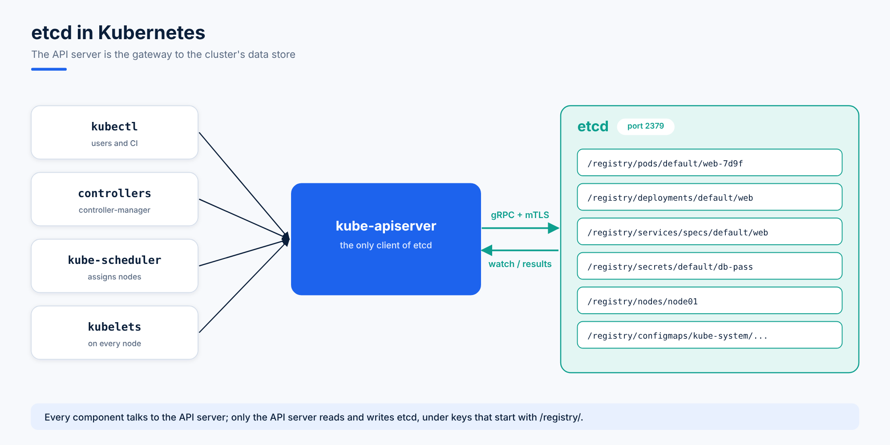
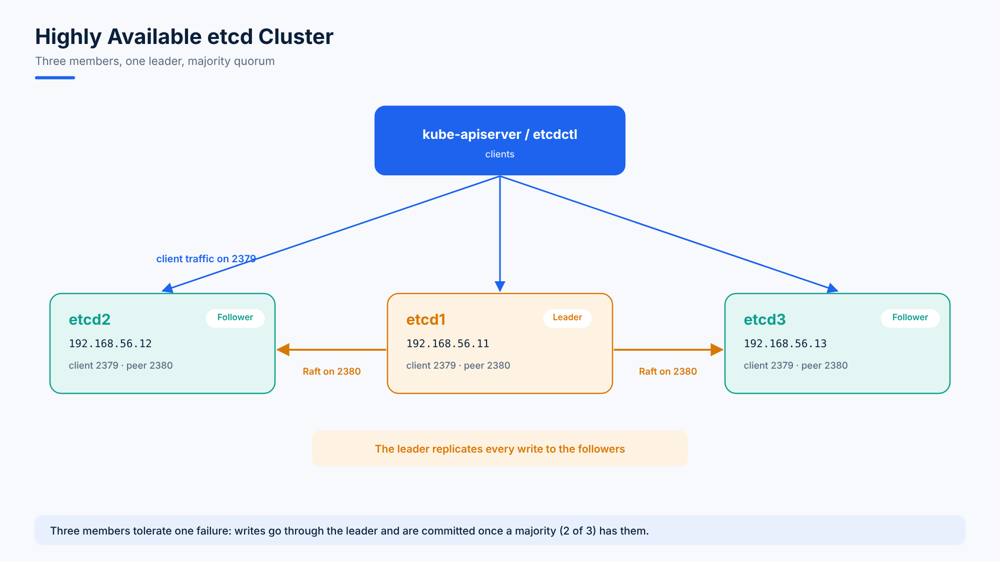

# 02. etcd in Kubernetes

## What the Master Keeps in etcd

The control plane's job is to **manage, plan, schedule and monitor** the nodes. Everything it knows about the cluster lives in the **etcd cluster**:

- Nodes
- Pods
- Configs (ConfigMaps)
- Secrets
- Accounts (ServiceAccounts)
- Roles
- Bindings
- Everything else (Deployments, ReplicaSets, Services, ...)

When you run `kubectl get pods`, the answer comes from etcd. When you create a Deployment, the change is only "real" once it is written to etcd.

## How the API Server Uses etcd



1. **etcd stores all configuration, state and metadata** of Kubernetes objects: pods, secrets, daemonsets, deployments, configmaps, statefulsets and more.
2. **Only the kube-apiserver talks to etcd** (over gRPC). Every other component goes through the API server.
3. etcd lets clients **subscribe to changes** with its **Watch()** API. The API server uses this to track changes to objects and notify controllers, the scheduler and kubelets.
4. Every object is stored under the **`/registry`** key prefix. For example, a pod named `nginx` in the `default` namespace lives at:

```
/registry/pods/default/nginx
```

Other prefixes follow the same pattern: `/registry/secrets/...`, `/registry/configmaps/...`, `/registry/deployments/...`, `/registry/roles/...`, `/registry/namespaces/...`.

## Two Ways to Set Up etcd

| Method | How |
|---|---|
| **Manual setup using the binary** | Download the etcd release, install it on the control-plane servers and run it as a **systemd service** |
| **Automatic setup with cluster tools** | kubeadm, Minikube or kind run etcd for you as a **static pod** in `kube-system` |

### Manual setup

Download and extract a release:

```bash
wget -q --https-only \
  "https://github.com/etcd-io/etcd/releases/download/v3.5.1/etcd-v3.5.1-linux-amd64.tar.gz"
tar -xvf etcd-v3.5.1-linux-amd64.tar.gz
```

Then run it with a systemd unit. The most important flags:

```ini
ExecStart=/usr/local/bin/etcd \
  --name ${ETCD_NAME} \
  --cert-file=/etc/etcd/kubernetes.pem \
  --key-file=/etc/etcd/kubernetes-key.pem \
  --peer-cert-file=/etc/etcd/kubernetes.pem \
  --peer-key-file=/etc/etcd/kubernetes-key.pem \
  --trusted-ca-file=/etc/etcd/ca.pem \
  --peer-trusted-ca-file=/etc/etcd/ca.pem \
  --peer-client-cert-auth \
  --client-cert-auth \
  --initial-advertise-peer-urls https://${INTERNAL_IP}:2380 \
  --listen-peer-urls https://${INTERNAL_IP}:2380 \
  --listen-client-urls https://${INTERNAL_IP}:2379,https://127.0.0.1:2379 \
  --advertise-client-urls https://${INTERNAL_IP}:2379 \
  --initial-cluster-token etcd-cluster-0 \
  --initial-cluster controller-0=https://${CONTROLLER0_IP}:2380,controller-1=https://${CONTROLLER1_IP}:2380 \
  --initial-cluster-state new \
  --data-dir=/var/lib/etcd
```

| Flag | Meaning |
|---|---|
| `--name` | This member's name |
| `--cert-file`, `--key-file` | TLS certificate and key for client connections |
| `--peer-*` | TLS for traffic between etcd members |
| `--client-cert-auth` | Clients must present a valid certificate |
| `--advertise-client-urls` | The address the API server uses to reach etcd (port **2379**) |
| `--initial-cluster` | Every member and its peer URL (port **2380**) |
| `--data-dir` | Where etcd stores its data |

### Setup with cluster tools

With kubeadm, etcd runs as a pod in `kube-system`, named after the control-plane node:

```
NAMESPACE     NAME                                 READY   STATUS    RESTARTS   AGE
kube-system   coredns-78fcdf6894-prwvl             1/1     Running   0          1h
kube-system   coredns-78fcdf6894-vqd9w             1/1     Running   0          1h
kube-system   etcd-master                          1/1     Running   0          1h
kube-system   kube-apiserver-master                1/1     Running   0          1h
kube-system   kube-controller-manager-master       1/1     Running   0          1h
kube-system   kube-proxy-f6k26                     1/1     Running   0          1h
kube-system   kube-proxy-hnzsw                     1/1     Running   0          1h
kube-system   kube-scheduler-master                1/1     Running   0          1h
kube-system   weave-net-924k8                      2/2     Running   1          1h
kube-system   weave-net-hzfcz                      2/2     Running   1          1h
```

List every key stored in it:

```bash
kubectl exec etcd-master -n kube-system -- etcdctl get / --prefix --keys-only
```

```
/registry/apiregistration.k8s.io/apiservices/v1.
/registry/apiregistration.k8s.io/apiservices/v1.apps
/registry/apiregistration.k8s.io/apiservices/v1.authentication.k8s.io
/registry/apiregistration.k8s.io/apiservices/v1.authorization.k8s.io
/registry/apiregistration.k8s.io/apiservices/v1.autoscaling
/registry/apiregistration.k8s.io/apiservices/v1.batch
/registry/apiregistration.k8s.io/apiservices/v1.networking.k8s.io
/registry/apiregistration.k8s.io/apiservices/v1.rbac.authorization.k8s.io
/registry/apiregistration.k8s.io/apiservices/v1.storage.k8s.io
/registry/apiregistration.k8s.io/apiservices/v1beta1.admissionregistration.k8s.io
```

Under `/registry` you'll find keys for **pods, secrets, replicasets, configmaps, roles, deployments** and more. (On real clusters `etcdctl` also needs the certificate flags shown in [topic 03](03.%20Exploring%20etcd%20on%20Minikube.md).)

## etcd in a High-Availability (HA) Setup



In production you run **several control-plane nodes**, each with its own etcd member. The members form **one cluster** and replicate every write to each other.

- Each member listens for clients on **2379** and for peers on **2380**.
- The key flag is `--initial-cluster`, which lists **every** member so they can find each other:

```
--initial-cluster controller-0=https://${CONTROLLER0_IP}:2380,controller-1=https://${CONTROLLER1_IP}:2380
```

- Use an **odd number** of members (3 or 5). A write needs a **majority (quorum)**: 3 members tolerate 1 failure, 5 tolerate 2.

> Building a 3-node HA etcd cluster by hand is the lab in [topic 04](04.%20Building%20a%20Highly%20Available%20etcd%20Cluster.md).
